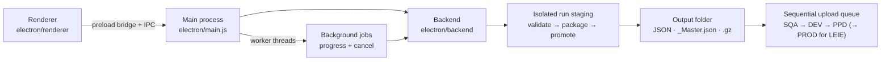
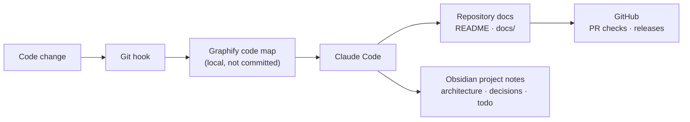

# CCRS File Processing Framework

[](https://github.com/mohamedmoheyeldin/ccrs-file-processing-framework-js/releases)
[](https://github.com/mohamedmoheyeldin/ccrs-file-processing-framework-js/actions/workflows/smoke-tests.yml)


> [!NOTE]
> A Windows desktop app that automates repetitive CCRS test-data work: it edits and generates referral files, prepares LEIE data, packages the results, and uploads them to approved test environments.

## Project mission

The CCRS File Processing Framework is an evolving team automation application. Its long-term purpose is to automate more repetitive team work, reduce manual effort, and give team members more time for meaningful testing, defect discovery, and prevention before production. LEIE and referral processing are the first two supported workflows, not the limit of the application. Additional capabilities can be prioritized and added as team needs evolve; they are not available until implemented and validated.

See [Project Vision](docs/PROJECT_VISION.md) for the broader direction and how to propose new workflows.

## Version 1.5.3

Release highlights for Version 1.5.3.

- Payment Authority Code: 43 unique values imported from the team PACodes.xlsx (Sheet1); pipe-separated cells are split and duplicates removed.
- Referral Number: VA or Custom. ICN: Default, Custom, or Referral Number.
- Output: individual formatted JSON and combined `_Master.json` can be retained independently. Gzip contains the same combined data; the manifest is generated only when requested. Matching names are overwritten after validation; unrelated files are preserved.
- Selections: one value stays fixed; subsets use only selected values; all clears the selected subset and selecting a value turns all off. Stations must be in the approved catalog and fit the five-character contract. Automatic regular SEOC uses approved Number/ID pairs; Situational SEOC remains optional.
- Uploads: one shared sequential queue for referrals and LEIE, retaining their separate remote-directory defaults. Each destination is attempted once per run; failure proceeds to the next server. Explicit retry handles only failed servers. Status shows the active server and completed-server count, not a simulated transfer-byte percentage. SFTP completion checks the remote file size; WinSCP reports its own transfer completion.
- Dialogs scroll at high zoom and on small displays. Setup distinguishes Install from Upgrade using the selected installation folder.


This project is a pure JavaScript Electron desktop app for working with CCRS referral files. It supports editing existing referral JSON files, generating new referral files, building final `.gz` packages, importing WinSCP upload settings, and uploading the finished archive to configured targets.

## Architecture



- Electron handles the desktop window, dialogs, IPC, and Windows packaging.
- The runtime logic lives under [electron/backend](electron/backend).
- The UI lives under [electron/renderer](electron/renderer).
- The canonical application logo is [assets/icons/ccrs_app_icon.png](assets/icons/ccrs_app_icon.png); its multi-resolution Windows counterpart is [assets/icons/ccrs_app_icon.ico](assets/icons/ccrs_app_icon.ico). Both are used by the renderer, application window, executable, installer, and uninstaller.

## Versioning
The single source of truth for the app version is [config/app_version.json](config/app_version.json).

Current structure:
```json
{
  "version": "1.5.3",
  "releaseTag": "v1.5.3",
  "label": "Version 1.5.3",
  "releaseNotes": [
    "Short list of release changes shown in the app the first time a user opens that release."
  ]
}
```

How it works:
- `version` is the internal numeric Windows build version and remains monotonic for installer upgrades.
- `releaseTag` is the public GitHub Release tag.
- `label` is the user-facing release name shown in the app badge and window title.
- `releaseNotes` powers the one-time What's New popup for each release. It appears after a fresh install and on the first launch after upgrading from an older release.
- `announcementId` must be unique for every release. The app compares it with the last acknowledged release stored in the user's AppData, so older acknowledgements never suppress newer notes.
- Current version: 1.5.3. Distribute the Setup installer and guides using the team-shared OneDrive folder. See [sharing checklist](docs/TEAM_SHARING_CHECKLIST.md).
- `pnpm start`, `pnpm test`, and `pnpm run dist` automatically synchronize package metadata from this file before running.

## Developer Run
Install dependencies once:
- `corepack enable`
- `pnpm install --frozen-lockfile`

Run the desktop app:
- `pnpm start`

Run smoke tests:
- `pnpm verify`

Run the real Electron end-to-end test:
- `pnpm run test:e2e`

## Build And Distribution
Release binaries are not stored in this repository. The GitHub Actions release workflow builds the Windows Setup installer in temporary runner storage, verifies it, publishes it to GitHub Releases, and then discards the temporary build files.

`pnpm run dist` uses the same temporary-directory build flow for troubleshooting. It does not create `dist-electron\` or `release\` in the project. Portable executables are not generated.

## Publish A GitHub Release
The [Build and publish Windows release](.github/workflows/release.yml) workflow creates a complete GitHub Release containing:
- the verified Windows Setup installer
- `SHA256SUMS.txt` for download verification
- configured release highlights from [config/app_version.json](config/app_version.json)
- curated release highlights from `config/app_version.json`

Before publishing:
1. Update `version`, `releaseTag`, `label`, `announcementId`, and `releaseNotes` in [config/app_version.json](config/app_version.json).
2. Commit and push the release changes to `main`.
3. Run the workflow manually from GitHub Actions, or push the configured release tag such as `v1.5.3` after approval.

The workflow requires the tag to match `releaseTag`. While a version remains the active release line, rerunning the workflow updates that same GitHub Release in place, replaces its two verified assets, and rebuilds the release body from the complete `releaseNotes` list so earlier highlights remain present. Start a newer version only after the release metadata is intentionally advanced.
It also refuses to build a release when `releaseNotes` is empty.

Pull requests and updates to `main` run functional smoke tests, a production dependency audit, and a Windows Electron end-to-end test. Release CI repeats those checks, builds the Setup installer, silently installs it, launches the installed app, verifies the executable, and then publishes it.

Full release notes are maintained in [docs/RELEASE_NOTES.md](docs/RELEASE_NOTES.md).

## Runtime Files
On first run, the packaged app creates or reuses these runtime folders:
- `config`
- `upload_import`
- `logs`
- `docs`
- `assets`

Runtime files are stored under the current user's AppData folder so the app can run without administrator rights, even when installed in `C:\Program Files`.

Files users commonly work with:
- `config\upload_profiles.json`
- `config\upload_credentials.json` (encrypted with Windows-protected storage after import)
- `docs\USER_GUIDE.pdf`

Files that are kept in sync from the shipped app:
- `config\app_version.json`
- `config\stations.json`
- `config\seoc_options.json`
- `docs\USER_GUIDE.md`
- `docs\USER_GUIDE.pdf`
- `docs\LEIE_UPLOAD_VALIDATION_GUIDE.md`

## Supported Workflows
- Process existing CCRS referral JSON files
- Process LEIE Excel files with strict full-row duplicate detection
- Keep the original LEIE source file name as the default output name
- Generate new referral JSON files from bundled templates
- Use the bundled CCN1 all-fields reference templates stored under `templates\referrals`
- Generate unique `999`-prefixed test SSNs and random DOBs per patient, or apply fixed overrides when needed
- Search all imported station rows by station key, station ID, VISN, station name, or parent station ID
- Search regular SEOC Number/ID pairs, or manually select from the separate nine-value Situational SEOC catalog when required
- Keep each referral's source Network automatically, choose one Network for every referral, or mix a selected subset or all available Networks across the batch
- Choose how ICNs should be generated: derive `TEST` plus the Referral Number body, keep `TEST`, or use a custom full ICN base
- Choose `VA` or a custom prefix for generated Referral Numbers
- Match the last 3, 4, or 5 characters of each Referral Number and ICN
- Produce final `.gz` archives
- Choose Referral Number, Network, Referral DateTime, or checkbox-built Custom JSON/gzip filename conventions with a live preview
- Import upload settings from `WinSCP.ini` or credentials JSON
- Upload Referral archives to `DEV`, `PPD`, or `SQA`; the separate LEIE workflow can also use `PROD`
- Test upload connectivity before running the full workflow
- Verify each LEIE upload and continue through every selected server even when one target fails
- Default every LEIE server upload to `/in/manual_process/` while retaining `/CCRA_Uploads` for referral workflows
- Automatically clean app-created temporary staging folders and upload helper files after a run or when the app closes
- Process long-running work in background workers with progress and cancellation
- Enforce configurable large-file and generation safety limits
- Stream referral gzip output to reduce peak memory use
- Export a sanitized diagnostic report without credentials or user file paths
- Review a complete safety summary before processing or upload
- Preserve unrelated output files through isolated per-run staging and collision checks
- Write a batch manifest with counts, uniqueness results, station distribution, hashes, and upload outcomes
- Open the current output, inspect its manifest, copy its path, or retry only failed uploads

## Station reference data

`config\stations.json` is the application's main station source. It contains every row and column imported from the approved Excel workbook, with blank and Excel `NULL` cells represented as JSON `null`. The Stations control displays and searches `station_key`, `station_id`, `visn_id`, `station_name`, and `parent_station_id`; selecting a row applies its `station_id` to referral data.

To refresh the structured source from a replacement workbook:

```bash
pnpm data:stations -- /path/to/stations.xlsx
pnpm verify
```

## SEOC reference data

`config\seoc_options.json` is generated from `SEOC.xlsx` and contains the regular catalog used automatically by referrals. `config\situational_seoc_options.json` contains the separate nine-value manual-only Situational catalog. The importer excludes every Situational Number/name identity from the regular catalog so the two dropdowns cannot overlap. Each option preserves its exact versioned SEOC ID and matching Number.

To refresh the SEOC catalog from a replacement workbook:

```bash
pnpm data:seoc -- /path/to/SEOC.xlsx
pnpm verify
```

## Version 1.5.3 Highlights

- Keeps the complete Version 1.4.1 experience and adds cleaner SEOC labels, Network assignment choices, a sequential upload queue that continues past a failed server, clearer recovery guidance, and calmer option-card highlighting.
- Accepts hyphens and underscores in Referral Number bodies and Custom prefixes while preserving live previews and unique generated values.
- Accepts lowercase, uppercase, and mixed-case text across user-entered fields without silently changing the user's capitalization.

## Version 1.4.1 Highlights
- Includes every Version 1.4 improvement listed in the historical notes.
- Keeps regular and Situational SEOC choices in separate, non-overlapping catalogs.
- Limits Situational SEOC to nine approved manual-only choices.
- Displays the complete SEOC ID with its matching Number directly underneath.
- Uses regular source SEOC values automatically and warns whenever a manual override is active.
- Expandable help makes the five-step workflow and its most important choices easier to understand.
- Live previews make it easier to confirm names, Station values, and other choices before creating files.
- Referral Number, ICN, Archive naming, and similar choices share one compact, professional design.
- Station, SEOC, and Situational SEOC selection is clearer, searchable, and reliable across different window sizes.
- Archive naming offers ready-made choices and an easy Custom checkbox builder.
- Referral and LEIE guidance now matches the selected task, including the upload destinations available to each workflow.
- User naming and selection choices return after restarting the app.
- Full current and historical notes are maintained in [docs/RELEASE_NOTES.md](docs/RELEASE_NOTES.md).

Previous release notes:

- Version 1.4
- Version 1.3.11
- Version 1.3.10
- Version 1.3.9
- Version 1.3.8
- Version 1.3.7 — internal release included in Version 1.3.8
- Version 1.3.6
- Version 1.3.5
- Version 1.3.4
- Version 1.3.3
- Version 1.3.2

## Validation And Testing
Developer setup, architecture, and test-layer details are maintained in [docs/DEVELOPMENT.md](docs/DEVELOPMENT.md), [docs/ARCHITECTURE.md](docs/ARCHITECTURE.md), and [docs/TESTING.md](docs/TESTING.md).

The app now validates key fields before processing and shows inline messages for common mistakes such as:
- invalid SSN format
- invalid referral number format
- invalid station ID format
- payment authority code values above the allowed 5-digit limit
- invalid date formats
- missing upload user or remote directory values

Smoke coverage lives in [scripts/smoke-test.js](scripts/smoke-test.js). The current smoke tests cover:
- payment authority code limits and generation
- referral number generation
- ICN generation modes
- Station catalog enforcement, random SSN/DOB generation, Referral/ICN suffix matching, and SEOC pairs
- optional override normalization
- invalid date rejection
- runtime cleanup of tracked temp artifacts
- upload profile summaries
- preview validation field errors
- secure credential imports, atomic settings writes, source limits, and streaming gzip output

The Windows Playwright test in [scripts/electron-e2e-test.js](scripts/electron-e2e-test.js) launches the actual Electron UI and verifies a background referral generation job.

## How this project is maintained

Documentation is treated as part of the code. The project is developed with an AI-assisted workflow that keeps the code, the repository docs, and the maintainer's notes in step.



| Tool | Role in this project |
|---|---|
| [Claude Code](https://claude.com/claude-code) | Development, reviews, and documentation updates, following [AGENTS.md](AGENTS.md) and [CLAUDE.md](CLAUDE.md). |
| [Graphify](https://pypi.org/project/graphifyy/) | Builds a knowledge graph of the codebase (functions, modules, and how they connect). It is rebuilt by git hooks on every commit and used to check the impact of a change before editing. Output lives in `graphify-out/`, which is ignored by Git. |
| [Obsidian](https://obsidian.md) | The maintainer's linked project notes: architecture summary, workflows, decisions with their reasons, and an open todo list. |
| [GitHub](https://github.com/mohamedmoheyeldin/ccrs-file-processing-framework-js) | Pull-request smoke tests, Windows end-to-end tests, and the release workflow that publishes the verified Setup installer. |

> [!TIP]
> To explore the code map locally: install Graphify (`uv tool install graphifyy`), then run `graphify extract . --code-only` and open `graphify-out/graph.html`. `graphify query "how does upload retry work"` answers questions from the map.

## Documentation map

| Document | Read it for |
|---|---|
| [Project Vision](docs/PROJECT_VISION.md) | Why the app exists and how new workflows are proposed |
| [Architecture](docs/ARCHITECTURE.md) | Process boundaries, safety design, data flow |
| [Development](docs/DEVELOPMENT.md) | Setup, change rules, release metadata |
| [Testing](docs/TESTING.md) | Test layers and when to run them |
| [User Guide](docs/USER_GUIDE.md) | Step-by-step use of both workflows |
| [LEIE Upload Validation Guide](docs/LEIE_UPLOAD_VALIDATION_GUIDE.md) | Checking LEIE uploads |
| [Stakeholder Overview](docs/STAKEHOLDER_OVERVIEW.md) | A short introduction for managers and the team |
| [Release Notes](docs/RELEASE_NOTES.md) | Every release, newest first |
| [Team Sharing Checklist](docs/TEAM_SHARING_CHECKLIST.md) | Distributing a release to the team |

## User Documentation
The user guide source lives in [docs/USER_GUIDE.md](docs/USER_GUIDE.md).
Packaged builds open the generated `docs/USER_GUIDE.pdf` from the app UI.

Team chat announcement: [copy the current release message](docs/RELEASE_UPDATE.md). It is regenerated from release metadata for each release.

## Stakeholder overview

Share [the stakeholder PDF](docs/STAKEHOLDER_OVERVIEW.pdf) with project managers, Scrum Masters, and team members for a concise introduction to the workflows, benefits, environment scope, and documentation. Its [Markdown source](docs/STAKEHOLDER_OVERVIEW.md) is maintained alongside the user guide.
